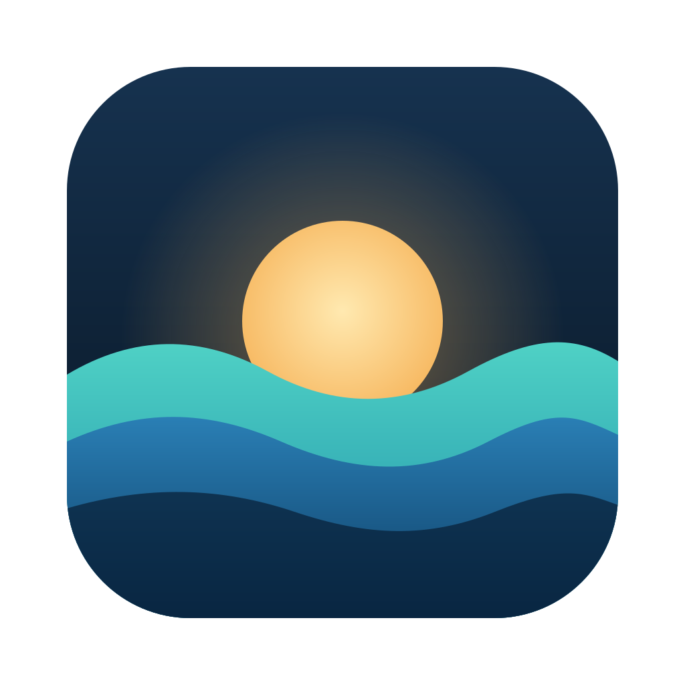

# Tide

A small menu bar (macOS) and notification area (Windows) app for a desk setup with a TV or external display.

| | macOS | Windows |
|---|---|---|
| Dim the display when you step away | ✓ lowers the display's brightness | ✓ darkens the picture in software |
| Volume keys control a soundbar through Homebridge | ✓ | — |

Dimming works the same on both, with the same menu items, settings and defaults. After 2 minutes without input the display fades to 25% over 1.2 seconds, and it comes back within 0.3 seconds when you return. It doesn't dim while an app keeps the display awake (video, calls), and it can be paused from the menu.

Each app lives in its own folder with its own `build.sh`:

- [`macos/`](macos): Swift, built with the Xcode Command Line Tools. [Jump to macOS](#macos).
- [`windows/`](windows): C# on .NET 10, built on macOS, Linux or Windows. [Jump to Windows](#windows).

## macOS

- **Dims idle external displays** by lowering their brightness. If you change the brightness yourself while dimmed, Tide leaves your setting alone.
- **Volume keys control the soundbar.** When the Mac's audio goes to the TV over HDMI (and on to a soundbar over eARC), macOS can't change the volume. While the TV is the output, Tide takes over the volume keys and sets the soundbar's HomeKit accessory through the Homebridge UI API instead, with a volume HUD like the system one.

### Requirements

- macOS 14 or later, with the Xcode Command Line Tools (`xcode-select --install`)
- For dimming: an external display whose brightness macOS can control (the same displays that respond to the brightness keys)
- For the soundbar: a Homebridge with [homebridge-config-ui-x](https://github.com/homebridge/homebridge-config-ui-x) exposing the soundbar volume as a fan (RotationSpeed), light (Brightness) or speaker (Volume)

### Build and install

```sh
macos/build.sh
```

This compiles `Tide.app`, signs it with your Apple Development certificate if you have one, copies it to `/Applications`, and opens it. Rerun it after any change; it quits the running copy first. `macos/build.sh --no-install` only builds `macos/build/Tide.app`.

Signing with a stable certificate matters: with an ad-hoc signature, macOS drops the Accessibility grant (and asks again for Keychain access) after every rebuild.

On first launch Tide opens its Settings window. Then:

1. Grant **Accessibility** when asked (System Settings → Privacy & Security → Accessibility). It's needed to intercept the volume keys. Dimming works without it.
2. In **Settings → Soundbar**, fill in the Homebridge address, username and password (and the two-factor secret if you use two-factor sign-in), pick the TV under **TV Audio Output**, then click **Test Connection**.
3. Turn on **Launch at Login** in the menu.

### Menu

| Item | What it does |
|---|---|
| Dim Display When Idle | Turns dimming on or off, with its current state underneath. |
| Pause Dimming | Only while dimming is on: **For 1 Hour**, **For 3 Hours**, **Until Tomorrow**, and **Resume Now** while paused. |
| Volume Keys Control Soundbar | Turns the soundbar control on or off, with its current state underneath. Followed by **Grant Accessibility Access…** or **Relaunch Tide** when needed, and a level slider that also picks up changes made with the TV remote. |
| Settings… | Opens the Settings window. |
| Launch at Login | Starts Tide when you log in. |
| Open Log | Opens `~/Library/Logs/Tide/tide.log`. |
| Quit Tide | Restores the display if it's dimmed, then quits. |

Shift-Option-volume changes the soundbar by 1.

### Settings

Everything is set in the Settings window; there are no environment variables or config files. Settings are UserDefaults in the `io.ruiying.Tide` domain (`defaults read io.ruiying.Tide`); secrets are in the login Keychain.

| Setting | Default | Stored in |
|---|---|---|
| Dim External Displays When Idle | on | `dim.enabled` |
| Dim After | 120 seconds | `dim.after` |
| Dimmed Brightness | 25% of the brightness before dimming | `dim.factor` |
| Fade Out / Fade In | 1.2 / 0.3 seconds | `dim.fadeOut`, `dim.fadeIn` |
| Control the Soundbar with the Volume Keys | on | `soundbar.enabled` |
| Address, Username | none | `soundbar.url`, `soundbar.user` |
| Password, Two-Factor Secret | none | Keychain, service `io.ruiying.Tide` |
| TV Audio Output | none (any output whose name contains the chosen name) | `soundbar.device` |
| HomeKit Accessory | `Soundbar Volume` | `soundbar.accessory` |
| Volume Step / Maximum Volume | 2 / 100 | `soundbar.step`, `soundbar.max` |

The Address is the Homebridge web page you sign in to, with its port (8581 by default), for example `http://hostname:8581`. The Two-Factor Secret is the one behind the authenticator QR code: base32, or the full `otpauth://` link. Tide generates a fresh code whenever it has to log in again.

### Command line

The app binary also works as a CLI:

```sh
T=/Applications/Tide.app/Contents/MacOS/Tide
$T brightness          # print current brightness (0.0–1.0) of the first external display
$T brightness 0.3 1.5  # fade all external displays to 0.3 over 1.5 seconds
$T soundbar            # show output device and current soundbar level
$T soundbar 20         # also set it to 20
$T status              # idle time, display-sleep assertions, brightness
```

### Caveats

- Brightness uses `DisplayServicesSetBrightness` from Apple's private `DisplayServices` framework. It could change or break in a future macOS release.
- Tested on one setup (Apple Silicon, one external display, a TV with a soundbar). Other monitors, docks and adapters may not accept brightness changes; `Tide status` shows whether a display is found.
- If Tide is killed outright while dimmed, the brightness to return to is kept in `~/Library/Application Support/Tide/dim.state` and restored the next time it starts.
- Launch at Login doesn't restart Tide if it crashes.
- This is not the screen saver or display sleep. Set those in System Settings as usual; Tide just adds an earlier, gentler step.

### Code layout

| File in `macos/` | Purpose |
|---|---|
| `Sources/main.swift` | Entry point: the command-line tools, or the app |
| `Sources/App.swift` | Menu bar item and menu, single instance, Launch at Login |
| `Sources/Dimmer.swift` | Idle → dim → restore, pause, preview, status text |
| `Sources/Brightness.swift` | External display brightness through DisplayServices |
| `Sources/Soundbar.swift` | Volume key interception, TV output detection, Homebridge client, volume HUD |
| `Sources/SettingsView.swift` | Settings window |
| `Sources/Settings.swift` | UserDefaults keys and defaults, Keychain |
| `Sources/Log.swift` | Logging |
| `Info.plist`, `build.sh` | App bundle info; build, sign and install |

## Windows

Dims only; there is no soundbar control.

Windows can't change the brightness of most TVs and many monitors, so Tide doesn't try. It fades in a black, full-screen window over everything else instead. As a result:

- **It works on any display**, including TVs and monitors with no brightness control from the PC.
- **It never touches the display's own settings,** so other devices connected to the same display are unaffected.
- **It can't leave the screen stuck dark.** If Tide quits or crashes, the black window goes with it.
- **On OLED screens it really reduces light and wear,** because darker pixels emit less. On LCD screens the backlight stays on.
- **The mouse pointer is hidden while dimmed.** Windows draws the pointer above every window, so it can't be dimmed. Tide hides it with a blank pointer that belongs to its own window, so no system setting changes.
- **The first click or scroll after dimming only wakes the screen.** While dimmed, the black window catches the mouse so it can hide the pointer. Moving the mouse, or pressing a key, wakes the screen without losing anything. Clicking straight away without moving first spends that click on waking.
- **Some exclusive full-screen games draw over it.** The screen then just doesn't dim during those games.

Tide doesn't dim in these cases, all detected without administrator rights:

| Situation | How it's detected |
|---|---|
| A full-screen app, game or presentation is in front | Windows' notification state (`SHQueryUserNotificationState`) |
| A call, or anything using the camera or microphone | Windows' privacy records of which apps are using them |
| A video is playing | The system media controls (the ones in the volume pop-up). Music players report themselves as music and don't count. Browsers often don't say, so browser playback counts as video. |

Game controllers count as activity: Xbox controllers, and others that appear to Windows as one (XInput). A PlayStation controller only counts when something such as Steam makes it look like an Xbox controller.

### Requirements

- To run: Windows 10 version 2004 or later, or Windows 11, 64-bit. It also runs on ARM PCs through Windows' x64 emulation. The exe includes the .NET runtime, so nothing else is needed.
- To build: the [.NET 10 SDK](https://dotnet.microsoft.com/download) on macOS, Linux or Windows. On a Mac: `brew install dotnet`.

### Build and install

```sh
windows/build.sh
```

This produces `windows/build/Tide.exe`, a single self-contained 64-bit Windows executable of about 80 MB. Rerun it after any change.

On the PC:

1. Put `Tide.exe` in `%LOCALAPPDATA%\Programs\Tide\` (where per-user apps live), or anywhere else permanent, and run it:

   ```powershell
   New-Item -ItemType Directory -Force "$env:LOCALAPPDATA\Programs\Tide" | Out-Null
   Move-Item .\Tide.exe "$env:LOCALAPPDATA\Programs\Tide\Tide.exe" -Force
   & "$env:LOCALAPPDATA\Programs\Tide\Tide.exe"
   ```

2. The exe isn't code-signed. If SmartScreen says "Windows protected your PC", choose **More info → Run anyway**. To avoid the warning, right-click the file first, choose **Properties**, and tick **Unblock**.
3. Tide opens its Settings window. Turn on **Launch at Login** in the menu.

Windows 11 may put the icon in the hidden part of the notification area (the ^ button). Drag it onto the taskbar to keep it in view. Running `Tide.exe` again while it's running just opens its Settings window.

To update, choose **Quit Tide**, replace the exe and run it again. If the file is still in use, stop Tide first with `Stop-Process -Name Tide`. To uninstall, turn off **Launch at Login**, quit, and delete the exe and `%LOCALAPPDATA%\Tide`.

### Menu

Right-click the tray icon for the menu; left-click opens Settings.

| Item | What it does |
|---|---|
| Dim Display When Idle | Turns dimming on or off, with its current state underneath, e.g. "Dims after 2 min idle", "Paused until 3:45 PM" or "Not dimming: video playing". |
| Pause Dimming | Only while dimming is on: **For 1 Hour**, **For 3 Hours**, **Until Tomorrow**, and **Resume Now** while paused. |
| Settings… | Opens the Settings window. |
| Launch at Login | Starts Tide when you sign in. Stored as the `Tide` value under `HKCU\Software\Microsoft\Windows\CurrentVersion\Run`, so it also shows in Task Manager's **Startup apps**. |
| Open Log | Opens `%LOCALAPPDATA%\Tide\tide.log` (rotated to `tide.log.1` at 1 MB). It records starts, dims, restores, pauses and why dimming was skipped. |
| Quit Tide | Restores the screen and quits. |

### Settings

Changes apply as soon as you make them, and are stored in `%LOCALAPPDATA%\Tide\settings.json`.

| Setting | Default | Range |
|---|---|---|
| Dim Display When Idle | on | |
| Dim After | 120 seconds | 5–3600 seconds |
| Dimmed Brightness | 25% of the picture before dimming | 5–90% |
| Fade Out / Fade In | 1.2 / 0.3 seconds | 0–10 seconds |

**Preview Dimming** dims with the current settings for a couple of seconds, even while dimming is off. **Reset to Defaults** restores the timing and brightness values.

### Troubleshooting

- **It never dims:** check the status line under Dim Display When Idle. "Not dimming: …" names the reason: a full-screen app, video playing, or the camera or microphone in use. An app that keeps the microphone open all the time, such as a voice chat sitting in a channel, counts as a call.
- **It dims during a video:** the player isn't full-screen and isn't reporting playback to the system media controls. Make the video full-screen, or use **Pause Dimming**.
- **It dims while you play with a controller:** the controller doesn't appear as an Xbox controller (see above).

### Code layout

WPF for the Settings window (with Windows' Fluent theme) and WinForms for the tray icon and the overlay. No third-party packages.

| File in `windows/` | Purpose |
|---|---|
| `App.xaml(.cs)` | Entry point: single instance, creates the dimmer and tray, shows Settings |
| `Tray.cs`, `Menus.cs` | Tray icon and its native Windows menu |
| `Dimmer.cs` | Idle → dim → restore, pause, preview, status text |
| `Overlay.cs` | The black click-through window and the pointer hiding |
| `Idle.cs` | Time since the last mouse, keyboard or controller input |
| `KeepAwake.cs` | Full-screen, camera/microphone and video checks |
| `SettingsWindow.xaml(.cs)`, `NumberField.cs` | Settings window |
| `Settings.cs` | Settings file, defaults and ranges, Launch at Login |
| `Log.cs`, `Native.cs`, `IconFont.cs` | Logging, Windows API declarations, icon glyphs |
| `Tide.csproj`, `app.manifest`, `build.sh` | Project (single self-contained exe, buildable from macOS), DPI awareness; build |

## License

MIT, see [LICENSE](LICENSE).
